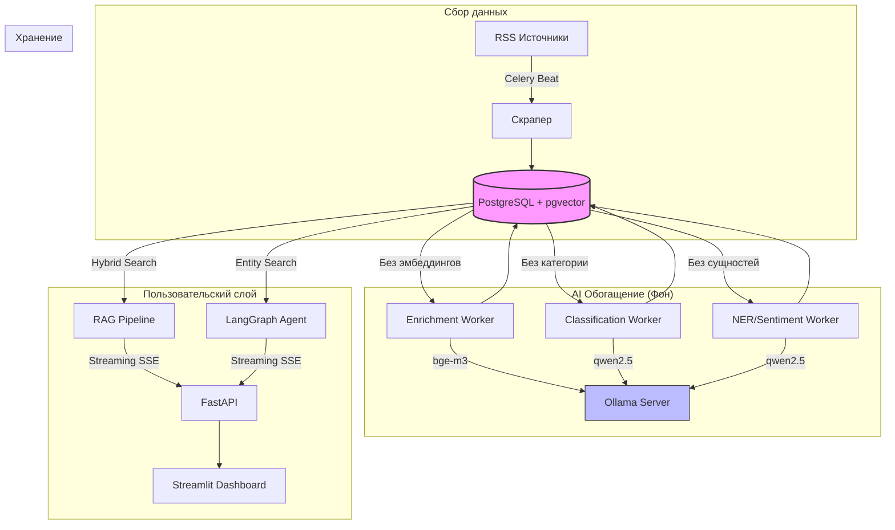

# Архитектура проекта News Scraper

Проект спроектирован с учётом принципов **изоляции доменной логики** и **устойчивости к внешним зависимостям** (self-hosted).

## Высокоуровневая схема

## Слои приложения (Clean Architecture)

Проект строго разделён на слои. Это позволяет менять LLM, БД или фреймворки без переписывания бизнес-логики.

### 1. domain/

Чистая логика. Здесь нет импортов SQLAlchemy, FastAPI или LangChain.
- models.py: Pydantic-модели для валидации данных (RawNewsItem).
- enums.py: Строгие перечисления (Category, Sentiment, Country).
- dedup.py: Логика хеширования для дедупликации статей.

### 2. db/

Слой персистентности.
- models/: SQLAlchemy-модели (ORM). Описание таблиц и индексов (включая pgvector HNSW и GIN для BM25).
- repositories/: Паттерн Repository. Инкапсулирует все SQL-запросы к базе.
- migrations/: Alembic. Версионирование схемы БД.

### 3. scraper/

Сбор данных.
- sources/: Каждый источник (Kommersant, TASS, WSJ) наследуется от RSSSource или реализует Protocol Source. Легко добавить новый источник (5 строк кода).
- parsers.py: Универсальный парсер RSS в Pydantic.

### 4. nlp/

Слой работы с LLM.
- classifier.py: Zero-shot классификация статей через Qwen.
- extractor.py: Извлечение NER и Sentiment через Qwen (с принудительным JSON-форматом).
- embeddings.py: Получение векторов через bge-m3.

### 5. rag/

Поиск и генерация (Retrieval-Augmented Generation).
- retriever.py: Гибридный поиск (BM25 + Vector + RRF + дедупликация).
- chains.py: RAG-пайплайн (поиск → промпт → стриминг ответа от Ollama).
- reranker.py: Опциональный Cross-Encoder (Jina).

### 6. agents/

LangGraph. Многошаговый агент.
- graph.py: State Machine. Узлы (planner, tools, finalize) и роутинг.
- tools.py: Инструменты агента (search_articles, get_metrics, search_by_entity).

### 7. api/

FastAPI. Слой контроллеров.
- routes/: Эндпоинты (/articles, /ask, /agent, /stats).
- schemas/: Pydantic-схемы для валидации запросов/ответов API (отдельно от домена).

## Потоки данных

### 1. Сбор и обогащение (Фон)

1. Celery Beat раз в час запускает scrape_all_sources.
2. Скрапер скачивает RSS, парсит и сохраняет в PostgreSQL (с дедупликацией по content_hash).
3. Celery Beat раз в 5 минут (или вручную) запускает enrich_batch (создание эмбеддингов).
4. Celery Beat раз в 6 часов запускает classify_batch (категории) и extract_batch (NER/Sentiment).

### 2. RAG Запрос (Online)

1. Пользователь задаёт вопрос в Streamlit.
2. POST /ask/stream принимает запрос.
3. retriever.py делает hybrid search (векторный + BM25), объединяет через RRF.
4. Найденные статьи подаются в промпт к Qwen (через Ollama).
5. Ответ стримится обратно в Streamlit через SSE.

### 3. Агентный Запрос (Multi-step)

1. Пользователь задаёт сложный вопрос (например, «Сколько негативных новостей про ЦБ за неделю?»).
2. LangGraph-агент анализирует запрос и решает, какой инструмент вызвать (get_metrics или search_by_entity).
3. Инструмент обращается к БД (с учётом JSONB сущностей).
4. Результат возвращается в агент, который формирует финальный ответ.

## Observability

- Langfuse: Все шаги RAG и LangGraph-агента трейсятся. В UI видно, сколько токенов потрачено, на каком шаге произошла ошибка и какие аргументы передавались в инструменты.
